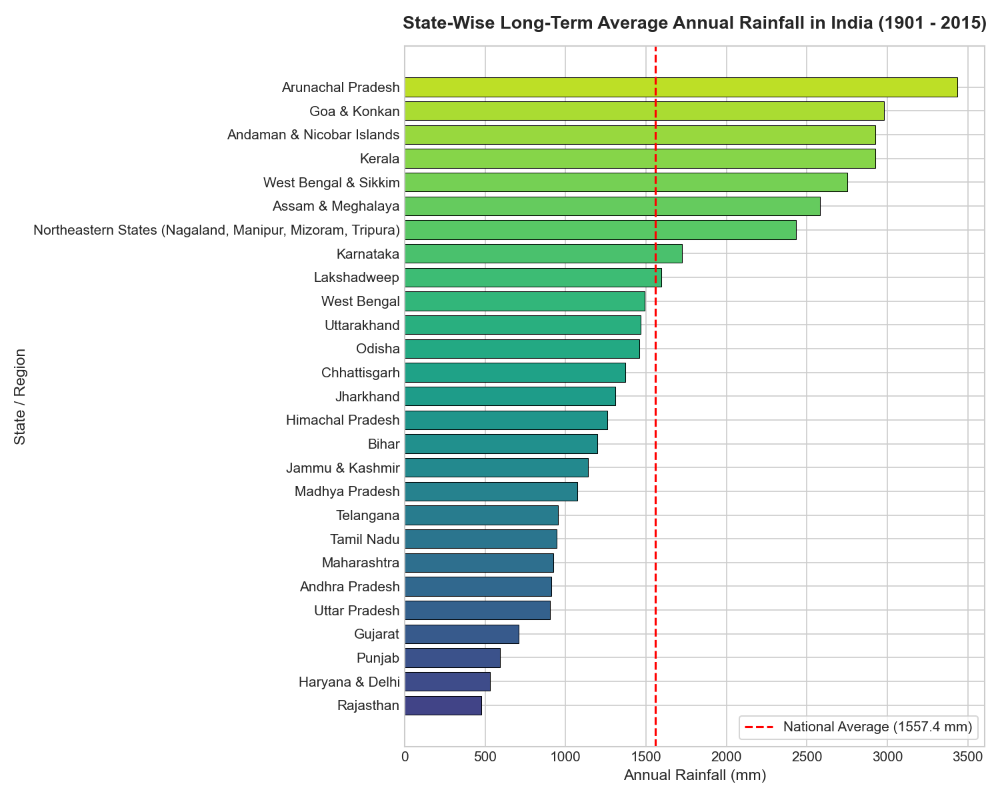
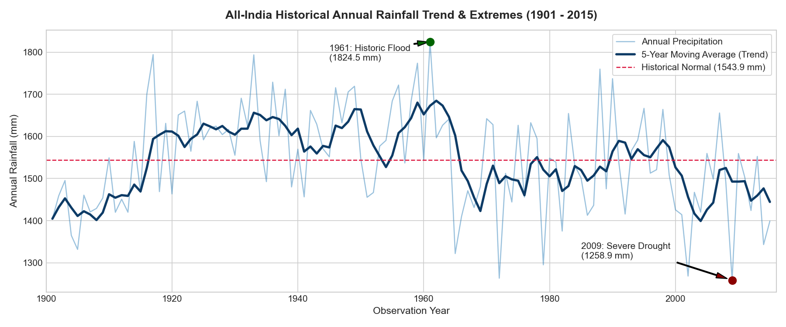
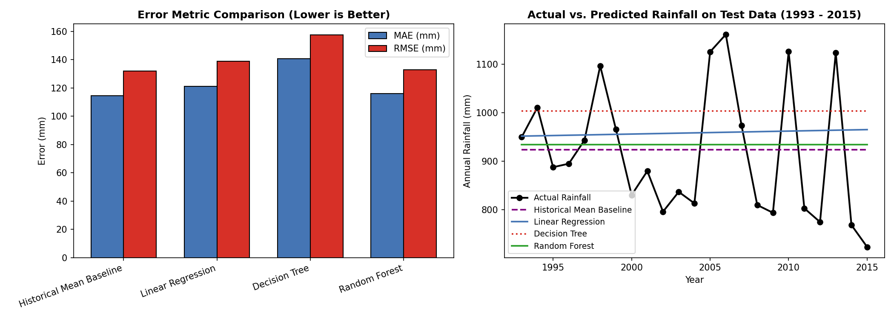

# State-Wise Annual Rainfall Analysis and Prediction in India Using Machine Learning

[](https://rainfall-prediction-india.streamlit.app)
[](https://github.com/LalitChoudhary-cloud/rainfall-prediction-india)
[](https://www.python.org/)
[](https://scikit-learn.org/)
[](#)
[](LICENSE)

An engineering hydrology and machine learning study evaluating **115 years ($1901–2015$)** of historical precipitation records from the **India Meteorological Department (IMD)** to assess spatial disparity, climatic trends, and multi-decadal predictive capabilities.

---

## 🌐 Live Interactive Web Application
🚀 **Try the Live Streamlit App:** [https://rainfall-prediction-india.streamlit.app](https://rainfall-prediction-india.streamlit.app)  
*(Select any Indian state, input target years, test prediction algorithms, and view dynamic hydrological uncertainty bands live in your browser!)*

---

## 📌 Project Overview & Research Question

> **"Can historical rainfall data be used to estimate the annual rainfall of an Indian state in a future year using basic Machine Learning algorithms?"**

Civil engineering structures like dams, reservoirs, spillways, and irrigation canals rely heavily on accurate precipitation estimates. This project benchmarks classical hydrological baselines against machine learning regression algorithms across Indian states using strict chronological train/test splitting.

---

## 📊 Key Highlights & Visualizations

### 1. Spatial Disparity Across India
India exhibits an extreme $7\times$ disparity in average annual rainfall — from over $3,400\text{ mm}$ in northeastern states (Arunachal Pradesh) to under $500\text{ mm}$ in western arid zones (Rajasthan).



### 2. 115-Year Historical Trends & Climatic Extremes
Evaluation of 115-year national rainfall records highlights significant climatic extremes, including the historic national flood year of **1961** ($1,824.5\text{ mm}$) and the severe drought of **2009** ($1,258.9\text{ mm}$).



### 3. Model Performance Comparison
Comparison of regression models on unseen future test horizon ($1993–2015$) for representative states.



---

## 📈 Model Evaluation (Maharashtra Unseen Test Horizon: 1993–2015)

| Model Name | MAE ($\text{mm}$) | MSE ($\text{mm}^2$) | RMSE ($\text{mm}$) | $R^2$ Score | Rank & Behavior |
| :--- | :---: | :---: | :---: | :---: | :--- |
| **Historical Mean Baseline** | **$114.52$** | **$17,397.61$** | **$131.90$** | **$-0.0020$** | **Rank 1 (Best)** — Climatological normal is the most robust |
| **Random Forest Regressor** | $115.98$ | $17,667.72$ | $132.92$ | $-0.0177$ | **Rank 2 (Best ML)** — 100-tree ensemble dampens step errors |
| **Linear Regression** | $121.16$ | $19,321.00$ | $139.00$ | $-0.1127$ | **Rank 3** — Simple linear drift over-penalizes cyclic variation |
| **Decision Tree Regressor** | $140.59$ | $24,818.84$ | $157.54$ | $-0.4296$ | **Rank 4 (Worst)** — Fails to extrapolate outside training bounds |

---

## 🔬 Scientific & Engineering Takeaways

1. **Climatological Baseline Superiority:** The 30/50-year historical mean remains the most reliable predictor for long-term water resources planning.
2. **Extrapolation Failure in Trees:** Decision tree regressors cannot extrapolate trends beyond the boundary values seen in training data, producing flat step predictions for future years.
3. **Atmospheric Stochasticity:** Calendar year alone (`YEAR`) cannot capture coupled ocean-atmosphere phenomena like **El Niño Southern Oscillation (ENSO)** and **Indian Ocean Dipole (IOD)**. Hence, civil engineers rely on empirical uncertainty bounds ($\pm 1\sigma$) rather than deterministic single-point forecasts.

---

## 🛠️ Repository Structure

```
.
├── data/
│   ├── rainfall in india 1901-2015.csv       # IMD 115-year official historical dataset
│   ├── district wise rainfall normal.csv     # 641 districts 30-year normals
│   ├── cleaned_historical_rainfall.csv       # Cleaned subdivision time series
│   └── cleaned_state_wise_rainfall.csv       # Aggregated state-wise dataset
├── graphs/                                   # High-resolution generated charts
├── src/
│   ├── clean_data.py                         # Hydrological cleaning & imputation
│   ├── generate_eda_plots.py                 # Script to reproduce all figures
│   └── build_notebook.py                     # Notebook synchronization utility
├── app.py                                    # Streamlit Web Application
├── streamlit_app.py                          # Streamlit Deployment Entrypoint
├── rainfall_prediction_project.ipynb         # Interactive Jupyter Notebook with ipywidgets
├── PROJECT_REPORT.md                         # Full academic project report
├── PRESENTATION_OUTLINE.md                   # 12-slide presentation structure
├── VIVA_QUESTIONS_AND_ANSWERS.md             # 65+ Viva Q&A
└── requirements.txt                          # Python dependencies
```

---

## 🚀 Getting Started

### 1. Clone the Repository
```bash
git clone https://github.com/LalitChoudhary-cloud/rainfall-prediction-india.git
cd rainfall-prediction-india
```

### 2. Set Up Virtual Environment & Dependencies
```bash
python -m venv venv
# Windows:
venv\Scripts\activate
# Linux/macOS:
source venv/bin/activate

pip install -r requirements.txt
```

### 3. Launch Streamlit Web App Locally
```bash
streamlit run streamlit_app.py
```

### 4. Or Run the Interactive Jupyter Notebook
```bash
jupyter notebook rainfall_prediction_project.ipynb
```

---

## 📚 References
* **India Meteorological Department (IMD)**, Ministry of Earth Sciences, Government of India.
* Subramanya, K. (2013). *Engineering Hydrology* (4th ed.). McGraw Hill Education.
* World Meteorological Organization (WMO). (2017). *Guidelines on the Calculation of Climate Normals*.
